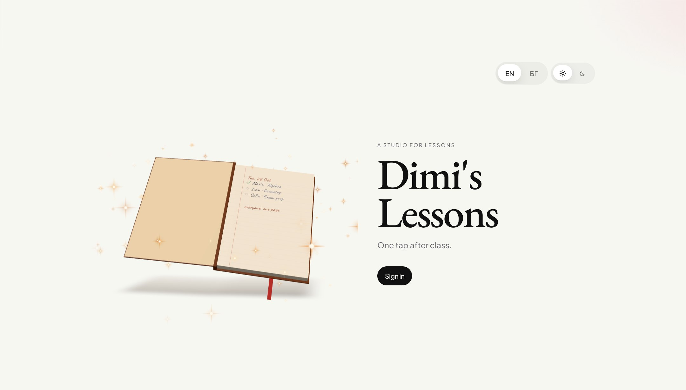
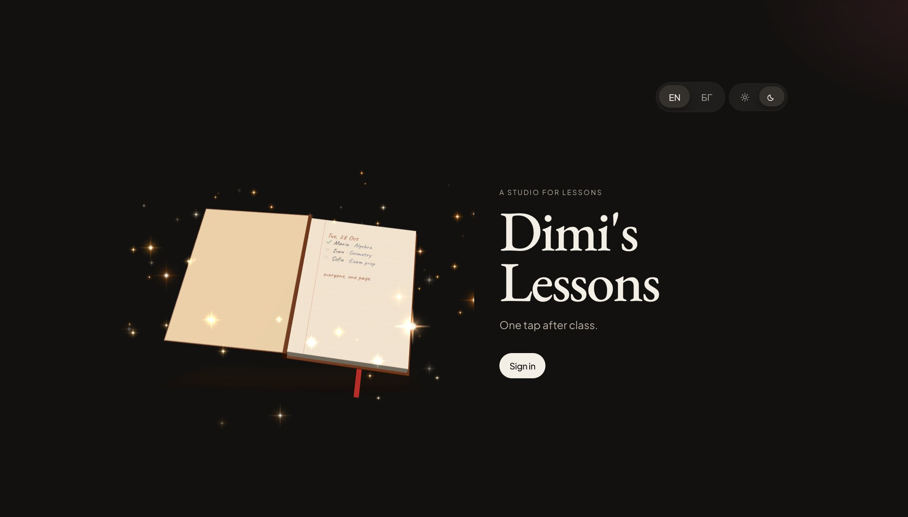
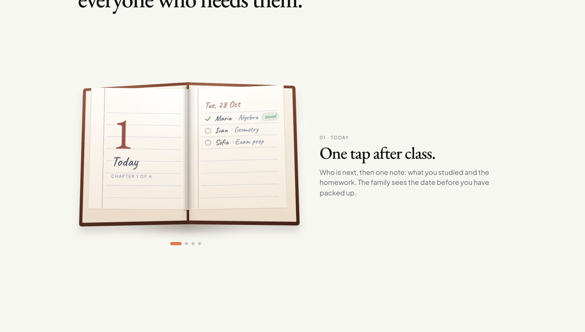

<div align="center">

# Dimi's Lessons

**A quiet studio for private lessons.**
What was studied, what is due, and what is paid, all in one place. It is written once and visible to the people who need it.

[](https://nextjs.org)
[](https://react.dev)
[](https://supabase.com)
[](https://tailwindcss.com)
[](https://www.typescriptlang.org)
[](#languages)

[Why it exists](#why-it-exists) · [What it does](#what-stays-in-the-open) · [Landing page](#the-landing-page) · [Tech stack](#tech-stack) · [Run it](#run-it) · [Security](#security-model) · [Changelog](CHANGELOG.md)


</div>

## Why it exists

I have run this tutoring practice on paper for four years. The notebooks worked. They also lived in one bag, so a parent, a student, and I were rarely looking at the same page.

This is that practice, digitized, so I can help myself, my students, and their parents. It is also for other private tutoring relationships that want the same thing: organise the work in a clean, subtle way, and keep it transparent and up to date.

## What stays in the open

| | Who | What they get |
|---|---|---|
| **Today** | Teacher | Who is next, and one tap after class: the material and the homework. |
| **Money** | Teacher | Prices, payments and prepaid packs. Open balances and packs running low sit where they can be seen. |
| **The family** | Parent | Reads every lesson, the homework and the payments, and leaves feedback. The record stays as the teacher wrote it. |
| **The student** | Student | What was studied and the homework waiting, under their own sign-in, with nothing about money. |

A parent can register a student. Nothing is opened until the teacher confirms it. The eleven user stories, each with a definition of success, are in [docs/user-stories.md](docs/user-stories.md).


## A ledger that stays quiet


Payments belong with the lessons, not in a separate spreadsheet. When everyone is up to date, the page says so and stays out of the way.

## For other tutors, if they want it


The rooms are simple: a teacher, the families they teach, and the students. Another private tutor can use the same rooms (today, money, signups, feedback) without turning the practice into a back office.

## The landing page

The first page is a notebook that comes alive. It is the paper practice, opened up.

| Light | Dark |
|---|---|
|  |  |

- **A real 3D notebook.** It is rendered with WebGL: leather with a clear coat, a gold-foil title and a ruled first page with today's list written by hand.
  - The cover swings open on load, a page turns every seven seconds, and the book leans towards the pointer.
  - The title and the handwriting follow the language: *Dimi's Lessons* or *Уроците на Дими*.
- **Stars.** Ninety four-point stars from a custom shader burst out of the pages when the cover opens, then orbit the book. They twinkle at their own pace, and a few flash.
  - In the light theme they read as gold leaf; in the dark theme they glow like a night sky.
- **The story.** “How it works” has four chapters: Today, Money, Family, Student. On desktop the notebook stays on screen and turns a page for each chapter, and every page is a small handwritten version of that room.



- **The film.** “See it in 40 seconds” is a taped photo that plays the film silently while it is on screen. A click opens it full size.


The 3D book loads after the text and stops rendering when it is off screen. Without WebGL, or with *Reduce motion* turned on, a lighter CSS notebook takes its place, and the page stays calm.

## Tech stack

| Layer | Technology | Notes |
|---|---|---|
| Framework | **Next.js 16.4** (App Router, Turbopack) | Server Components and Server Actions; `src/proxy.ts` replaces the old `middleware.ts`. |
| UI | **React 19.3**, **Tailwind CSS 4.3**, **Motion 14** | Design tokens live in `src/app/globals.css` (`@theme`), with a light and a dark theme. |
| 3D | **Three.js 0.186**, **React Three Fiber 9**, **drei 10** | The WebGL notebook on the landing page, loaded lazily, with a CSS fallback. |
| Data and auth | **Supabase**: Postgres, Auth, Row Level Security | `@supabase/ssr` for cookie sessions, `@supabase/supabase-js` for the server-only admin client. |
| Languages | **next-intl 4** | `/en` and `/bg` routes; all copy is in `messages/en.json` and `messages/bg.json`. |
| Fonts | `next/font/google` | EB Garamond (display), Plus Jakarta Sans and Nunito (text), Caveat (handwriting on the landing page). |
| Language and tooling | **TypeScript 6**, ESLint 9 (`eslint-config-next`) | `npm run lint`, `npx tsc --noEmit`. |
| Hosting | **Vercel** + Supabase in an EU region | `https://dims-lessons.vercel.app` |

### How the pieces fit

```text
Browser ──► src/proxy.ts ──► next-intl locale + Supabase session refresh
              │
              ▼
   app/[locale]/(teacher)   today · money · registrations · feedback · settings · clients/[id]
   app/[locale]/(parent)    family · family/[id] · family/payments · family/feedback
   app/[locale]/(student)   my
   app/[locale]/            landing · login · register · join · student · auth/*
              │
              ▼
   src/lib/actions.ts  (Server Actions)  ──►  src/lib/db.ts  ──►  Supabase Postgres (RLS)
   src/lib/auth.ts     (who is signed in, which room they may enter)
   src/lib/supabase/admin.ts  (service role, server only: student PIN sessions, parent invites)
```

### Database

The schema is in [`supabase/migrations`](supabase/migrations). Apply the files in order.

| Table | Holds |
|---|---|
| `profiles` | Teacher and parent accounts (role, contact details, public code). |
| `clients` | The people a teacher teaches: subject, platform, place, price, billing mode. |
| `client_parents` | Which parent may read which student. |
| `lessons` | Date, subject, platform, place, materials, homework. |
| `payments` | Amount and lessons added to a prepaid pack. |
| `registrations`, `parent_requests` | Signups and link requests waiting for the teacher. |
| `feedback_requests`, `feedback_notes` | Parent feedback and the teacher's private notes. |
| `student_pins`, `student_sessions` | Hashed student PINs and their 30-day sessions. |

## Run it

**1. Supabase**

1. Create a project in an EU region.
2. In Authentication, set the site URL to `https://dims-lessons.vercel.app` and add `https://dims-lessons.vercel.app/**` as a redirect URL.
3. Apply the migrations in the SQL editor, in order: [0001_init.sql](supabase/migrations/0001_init.sql), then [0002_fix_profile_rls.sql](supabase/migrations/0002_fix_profile_rls.sql).
4. Turn on database backups before any real names are stored.
5. Create the teacher user in Authentication with the same email as `TEACHER_EMAIL`. The profile row is created on the first sign-in. The studio starts empty.

**2. Locally**

```bash
cp .env.example .env.local   # fill in the values below
npm install
npm run dev                  # http://localhost:3000
```

| Variable | Where it is used |
|---|---|
| `NEXT_PUBLIC_SUPABASE_URL` | Browser and server. |
| `NEXT_PUBLIC_SUPABASE_ANON_KEY` | Browser and server. The publishable key (`sb_publishable_…`) or a legacy anon key. |
| `SUPABASE_SERVICE_ROLE_KEY` | **Server only.** Student PIN sessions and parent invites. Never expose it. |
| `TEACHER_EMAIL` | The account that becomes the teacher on first sign-in. |
| `NEXT_PUBLIC_SITE_URL` | Base for email links, e.g. `https://dims-lessons.vercel.app`. |

The landing page works without Supabase, which is handy for design work.

**3. Vercel**

Deploy this Next app with the same environment variables. `NEXT_PUBLIC_SITE_URL` must match the Supabase site URL. Parent email links use `/en/auth/confirm` or `/bg/auth/confirm`, both covered by the `/**` redirect. Point Supabase mail at your own domain before inviting more than one family.

## Security model

- **Teacher and parents** sign in through Supabase Auth. Every table is protected by Row Level Security, so a parent only reaches the students linked to them.
- **Students** sign in with the name the teacher wrote and a 4–6 digit PIN. The PIN is stored hashed (scrypt), and the session cannot read payments or feedback.
- **Server Actions** check the role and the ownership of the record before every write.
- The **service role key** is used only in `src/lib/supabase/admin.ts`, which is marked `server-only`.

## Languages

Every route exists in English (`/en`) and Bulgarian (`/bg`). New copy goes into both `messages/*.json` files under the same key.

## The film

The landing page carries a 40-second film in English, with text only and no voice-over: `public/video/dims-lessons-film.mp4` (4 MB, 1920×1080, H.264), plus a poster frame.

| Time | Scene | Made with |
|---|---|---|
| 0–11 s | A stack of leather notebooks on a desk. The top one, *Dimi's Lessons*, slides forward and opens on today's page. | [Blender](https://www.blender.org) 5 (Eevee, depth of field, motion blur, bloom) |
| 11–31 s | Today, Money, Family, Student: the four rooms, animated | [Remotion](https://www.remotion.dev) 4 (React) |
| 31–40 s | Sign-off: *Dimi's Lessons, one tap after class.* | Remotion |

The source is in the Wavsy videos repository: `src/dims-lessons/` for the film and the textures, and `blender/dims_book.py` for the 3D shot.

## Project layout

```text
src/
  app/[locale]/        routes per role, plus landing, login and auth callbacks
  components/          UI: book-3d (WebGL notebook and stars), book-mark (CSS fallback),
                       notebook-story, studio-film, boards, forms, small games
  i18n/                next-intl routing and request config
  lib/                 auth, server actions, database access, formatting, stats
  proxy.ts             locale routing and session refresh
messages/              en.json, bg.json
supabase/migrations/   SQL schema, RLS policies and functions
public/                images, the film, and assets for the small games
docs/                  user stories and README images
```

## Changelog

Every change is written down in [CHANGELOG.md](CHANGELOG.md): what changed, why, and what to check.
